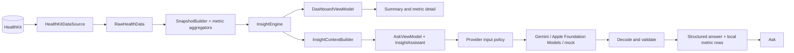

# Rezilient wearable insight prototype

A native SwiftUI iOS prototype that reads steps, sleep, and resting heart rate from HealthKit. It summarizes changes across completed periods and lets a member ask questions about the displayed data. The prototype uses Gemini by default when configured, Apple Foundation Models for concise on-device summaries, and a deterministic mock for offline development.

## Run

Requires Xcode 27 and an iOS simulator or device. The app has no third-party runtime dependencies.

1. For live Gemini answers, copy `Config/Secrets.example.xcconfig` to the gitignored `Config/Secrets.xcconfig` and set `GEMINI_API_KEY`. Without a key, the app uses its simulated provider. `GEMINI_MODEL` selects the primary model; `GEMINI_ALTERNATE_MODELS` adds model choices; `ASSISTANT_PROVIDER` optionally selects `gemini`, `apple`, or `mock` at launch.
2. Open `RezilientHealth.xcodeproj`, run the `RezilientHealth` scheme, and connect Apple Health when prompted. Apple Foundation Models requires a supported device with Apple Intelligence available.
3. In the Debug build, open Developer options → **Seed demo story (rough last week)**. This writes synthetic HealthKit samples so the app exercises its real HealthKit read path. The data is not personal. **Remove seeded data** deletes only samples written by this app.
4. Ask “Should I get more steps?” to see a live Gemini response, its separately labeled general wellness information, and locally filled metric evidence. In Ask, the CPU menu switches between available providers.

Run the model and presentation tests on macOS:

```sh
swift test --package-path Packages/InsightCore
```

### Reproduce important states

| State | Steps |
| --- | --- |
| Missing or limited data | Before seeding, choose **Remove seeded data**. HealthKit does not tell an app whether read permission was denied, so the dashboard explains that no visible data can mean access is off or nothing has been recorded. The Debug menu’s Health diagnostics can inspect sample visibility. |
| Gaps, partial, and stale data | Choose **Seed typical 6 months (with gaps)** or **Seed sparse + stale data**. Missing days stay missing, today is marked partial where applicable, and stale readings are labeled. |
| Unsupported question | Ask “How many calories did I burn?” for an unsupported-data response, or “Do I have sleep apnea?” for a clinician boundary. Emergency phrases receive a local safety response without calling a model. |
| AI failure | In Debug, select Developer options → Assistant backend → **Simulated: timeout** (or service error / malformed reply). Submit a question; the app keeps it and offers retry where appropriate. |

## Data and answer flow

The app keeps the calculations and displayed numbers deterministic. The model can explain the prepared summary, but it cannot provide the values displayed in metric rows.



HealthKit provides daily quantity totals and sleep intervals. `SnapshotBuilder` creates the selected window from daily readings; missing values remain `nil`. Sleep intervals are merged before asleep duration is calculated. `InsightEngine` averages recorded completed days, requires at least half-period coverage, and compares the current period with the prior one. Today remains visible in charts but is excluded from comparisons. The dashboard builds a short pattern from qualifying changes and shows the source coverage beside them. These selection thresholds are product heuristics, not clinical cutoffs.

The dashboard and Ask view models depend on protocols. HealthKit access, Gemini, Apple Foundation Models, and simulation are adapters composed in the app target. `MetricCatalog` defines the enabled metric set; metric-specific aggregation and rendering remain explicit where signals differ.

Each model adapter declares its execution location, input policy, and answer style. Gemini receives the dashboard summary and may return observations plus general wellness information. Apple Foundation Models receives only the relevant summary and generates a concise takeaway; the app keeps the rest on device and adds metric values and boundary notes locally. There is no silent switch from on-device to cloud. All responses use one structured contract, then the shared validator removes metric claims unsupported by the exact context sent. Values, ranges, and coverage shown in chat come from that captured local context.

`Evaluation/2026-10-19-live.json` contains exact instructions, structured context, and validated model output for eight fixed synthetic questions. In the app, **What the assistant saw** shows the exact input for a live answer. Providers return the same JSON contract; the app decodes it, validates metric references against the sent context, and fills numerical evidence locally.

## Design decisions

**Calculate health facts locally.** The model is not asked to do arithmetic over raw readings. This improves reproducibility and limits the context sent to a cloud provider. Questions requiring a relationship the app has not calculated remain outside the prototype’s data-backed claims.

**Treat missing data as missing.** Missing days are excluded from averages and shown as gaps; a recorded zero remains a real reading. HealthKit hides read-denial status, so the UI does not claim to know whether a blank result means denied access or no samples. Partial today values do not affect period comparisons.

**Use a structured, replaceable model adapter.** The shared assistant validates provider output and exposes unsupported-data, clinician, timeout, and malformed-response states. Gemini supports broader explanations; Apple’s adapter is summary-only because testing found that its broader freeform output could invent unsupported claims. Model parity is not assumed.

## Limits and next steps

This is a prototype, not a clinical product. The week-to-week thresholds, sleep-night boundary, and freshness window need validation with members. HealthKit access can be incomplete without an observable denial state. The sample seeder writes synthetic records only in Debug. The Gemini key is embedded in the app build and is extractable; real member use requires a backend proxy, consent for cloud processing, identity and access controls, and privacy-safe observability. The HealthKit fallback for older quantity samples can undercount when multiple sources cover different parts of a day. There is no persistence, localization, or validated clinical guidance.

For production, first validate the aggregation and insight rules against opted-in real device data. Then move cloud model access behind an authenticated backend with consent and versioned prompts. A later increment can add background refresh and a member-controlled weekly insight. The core and presentation boundaries are isolated from HealthKit and SwiftUI; an Android implementation would translate those boundaries into Kotlin, use Health Connect and Compose, and account for its different permission and history rules.

## Assignment notes

**Time spent:** Approximately 3 hours.

**AI use:** Codex helped critique and implement the app’s data flow, model adapters, and SwiftUI screens, and draft this README. The changes were checked with iOS builds and Simulator trials. An initial Apple model implementation returned unrelated metrics and an inaccurate missing-sleep claim; after that check, the adapter was scoped to concise, relevant takeaways, with values and boundary notes supplied locally.

**Starter code:** Started from Xcode’s SwiftUI app template. No third-party runtime dependencies.

## Demo

Watch the [unedited demo recording on Loom](https://www.loom.com/share/e806f48a2e96410e9e3194b615761786). It uses the seeded HealthKit story, shows the summary and metric detail, demonstrates the Ask flow, and walks through the unsupported-data and clinician boundaries. The readings are synthetic and are read through the app's HealthKit integration. The walkthrough notes are in `Evaluation/NOTES.md`.
