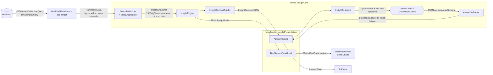

# Rezilient: Wearable Insight Prototype (iOS)

A SwiftUI app that reads steps, sleep, and resting heart rate from **HealthKit**, shows 14 days plus today with week-over-week insights, and lets the member ask questions. **Google Gemini** answers them using only an on-device summary, through a structured JSON contract.

## Run it

Requirements: Xcode 27, iOS 27 simulator or device. No third-party dependencies.

1. Optional, for real AI answers: `cp Config/Secrets.example.xcconfig Config/Secrets.xcconfig` and set `GEMINI_API_KEY` (and `GEMINI_MODEL` if you don't want `gemini-flash-latest`). Without a key the app uses a deterministic mock, and every answer is labeled **"Simulated"**.
2. Open `RezilientHealth.xcodeproj`, run the `RezilientHealth` scheme, and tap **Connect** to grant Health access.
3. On a simulator, open the 🔧 menu and choose **Seed typical 2 weeks (with gaps)**. This writes synthetic samples into HealthKit, so the dashboard then exercises the real read path. **Remove seeded data** deletes only samples this app wrote.
4. Tests (29, Swift Testing, no simulator needed): `cd Packages/InsightCore && swift test`

### Reproducing the edge cases

| Case | How |
|---|---|
| No data / access limits | Before seeding, or after **Remove seeded data**: the app shows "We can't see any health data". HealthKit never reveals denied *read* access, so the copy says that either access is off or nothing was recorded. You can also turn individual metrics off in Settings › Health › Data Access. iOS 27 also lets the member share only the past 30 days. |
| Gaps, partial, stale | The typical seed has 2 days without steps or heart rate (gray columns, excluded from averages) and 2 missing nights. Today's steps show as a lighter "so far" bar and are excluded. **Seed sparse + stale** produces "Not enough recent data" and "Last recorded Oct 6…". |
| Question limits | "How many calories did I burn?" returns `insufficient_data` (not tracked). "Do I have sleep apnea?" returns `needs_clinician`. "I have chest pain" gets a local safety message, and the model is never called. |
| AI failure | 🔧 › Assistant backend › **Simulated: timeout / service error / malformed reply**. The question stays in the field with a Retry button, and no answer is shown. With a real key, a wrong key or airplane mode exercises the real Gemini error path. |

## Architecture (MVVM)

| Layer | Where | Responsibility | Depends on |
|---|---|---|---|
| **Model** | `Packages/InsightCore` | Health data types, aggregation, insight math, model contract, Gemini/mock clients, answer validation. No UI, no wording. | Foundation |
| **ViewModel** | `Packages/InsightPresentation` | `DashboardViewModel`, `AskViewModel`: `@Observable` state, intents (`load`, `connect`, `submit`, `retry`), and every member-facing string and accessibility label. | InsightCore + protocols |
| **View** | `RezilientHealth/*View.swift`, `MetricCard.swift` | SwiftUI rendering and styling (icons, colors, layout). No formatting, no business rules. | ViewModels |
| **Composition root** | `RezilientHealthApp.swift`, `AppConfiguration.swift` | The only place that creates concrete `HealthKitDataSource`, `SampleDataSeeder`, and `GeminiClient`/`MockModelClient`. | Everything |

View models only see protocols (`HealthDataSource`, `SampleDataSeeding`, `InsightModelClient`), so they're unit tested with fakes on macOS (no simulator, no HealthKit).



**Implemented:** everything above. **Proposed, not built:** backend proxy, persistence, auth, telemetry (see Production).

Take one step sample through the system. HealthKit's statistics query sums and de-duplicates iPhone and Watch samples into one bucket per day. A day with no samples is **omitted**, never reported as 0. `SnapshotBuilder` lays out a fixed 15-day grid where that day is `value: nil`, and today is `isPartial`. `InsightEngine` averages only completed days that have data, and requires at least 4 of 7 before it shows an average or a comparison. `DashboardViewModel` turns those facts into a `MetricCardState` (headline, coverage line, chart points with VoiceOver text), and the view draws the gap as a gray column. `InsightContextBuilder` sends the same daily values and the engine's averages, rounded rounded per metric (whole steps and bpm, sleep to the minute) so the model quotes exactly what the dashboard shows. The model returns `observations` (each citing metric keys), `general_info`, and `limitations`. `AnswerValidator` drops any observation that cites a metric with no data and tells the member it did so.

## Three consequential decisions

**1. Deterministic numbers on device; the LLM only explains them.**
*Constraint:* answers must be accurate and reproducible, and health numbers must not be invented. *Alternative:* send raw samples and let the model compute. *Why not:* LLM arithmetic over hundreds of samples is unreliable and hard to test. Raw samples also leak more data (timestamps, sources) than the question needs. Our engine is unit tested, and the model receives about 3 KB of aggregates. *Revisit:* when questions need analysis we haven't pre-computed (for example correlations). Then I'd add more computed features, or a tool-calling layer where the model asks the app for specific aggregates, rather than shipping raw data.

**2. Missing data is a first-class state, never zero.**
*Constraint:* HealthKit hides denied read access, devices go uncharged, and today is incomplete. *Alternative:* zero-fill, the default in many chart libraries and in `HKStatisticsCollection` enumeration code. *Why not:* zero-filling turns "watch on the charger" into "inactive day". In the test fixture, 5 recorded days averaging 8,000 would become 5,714. We track three distinct states (no data, partial, stale), require minimum coverage, and print the coverage under every insight. *Revisit:* if product wants an inferred "likely not worn" state, for example under 200 steps with no heart rate. That needs real-world data to tune.

**3. A structured, validated model contract with a mock behind the same protocol.**
*Constraint:* we must separate data-backed observations from general advice, handle diagnosis questions, and never show an unchecked answer. *Alternative:* free-text chat with a disclaimer. *Why not:* free text can't be checked, so the UI can't show which claims are grounded. Gemini's `responseSchema` enforces the shape. The validator enforces grounding, and anything that doesn't parse becomes `unreadableResponse` rather than raw text. The protocol also makes failures reproducible in tests and demos. Because the reasoning happens on device, the model doesn't need its own: in live testing, Gemini's default "thinking" took 15–58 s per answer and hit our 20 s timeout, while `thinkingBudget: 0` answered in about 1.5 s. Capacity errors (503/429) were frequent but came back in under a second, so they get exactly one retry; everything else fails immediately. *Revisit:* streaming responses would need incremental validation. A moderation or grounding check on the server would replace part of the client validator.

## Model contract

**Input** = `InsightPrompt.systemInstruction` (rules: use only the given numbers, null ≠ zero, cite metrics, `insufficient_data` / `needs_clinician`, ignore instructions embedded in the question) + this context (trimmed; the full version is under "What the assistant was given" in the app):

```json
{
  "window": { "start": "2026-10-01", "end": "2026-10-15", "timezone": "America/Los_Angeles",
              "note": "Daily values are calendar-day totals (sleep: the night ending that morning). Today is in progress for steps and resting heart rate." },
  "health_access": "requested",
  "access_note": "Access was requested. The platform does not reveal whether read access was denied, ...",
  "metrics": {
    "steps": {
      "status": "ok", "unit": "steps", "stale": false, "last_sample_at": "2026-10-15T14:00:00-07:00",
      "last7_days":     { "start": "2026-10-08", "end": "2026-10-14", "average": 8259.4, "days_with_data": 5, "days_in_period": 7, "sufficient": true },
      "previous7_days": { "start": "2026-10-01", "end": "2026-10-07", "average": 5793,   "days_with_data": 7, "days_in_period": 7, "sufficient": true },
      "daily": [ {"date":"2026-10-09","value":8178}, {"date":"2026-10-10","value":null}, {"date":"2026-10-15","value":3900,"partial":true} ]
    },
    "sleep": { "status": "no_data", "last7_days": { "days_with_data": 0, "sufficient": false }, "...": "..." },
    "resting_heart_rate": { "status": "ok", "...": "..." }
  },
  "not_tracked_in_this_app": ["heart_rate_variability", "workouts", "calories", "blood_pressure", "..."]
}
```

**Output** (Gemini `responseMimeType: application/json` + `responseSchema`). For example, "Do I have sleep apnea?":

```json
{ "status": "needs_clinician",
  "observations": [ { "text": "Over Oct 8–14 your steps averaged 8,259 on 5 of 7 days with data…", "metrics": ["steps"] } ],
  "general_info": [ "Wearable trends can't diagnose a condition or guide treatment…" ],
  "limitations":  [ "This app doesn't make diagnoses…", "Sleep: no data in the last 7 days." ] }
```

The app decodes this into `InsightAnswer`, then `AnswerValidator` runs. The UI renders "From your data" (with metric chips), "General wellness info — not based on your data", and "Limits of this answer", plus a stethoscope or "can't fully answer" banner when the status calls for one. **Boundaries:** unsupported data → `insufficient_data`. Diagnosis or treatment → `needs_clinician`. Emergency phrases → local message with 911/988, and no model call. HTTP error (after one retry for 503/429), timeout (20 s), offline, safety block, or malformed JSON → typed `AskFailure`; the question is kept and Retry is offered when it makes sense.

## Production evolution

- **Local storage:** none today; everything is recomputed from HealthKit on launch. Next: cache snapshots, not raw samples, in an encrypted store with file protection `.complete`, and use `HKObserverQuery` with background delivery for freshness.
- **Backend & model access:** the key in the app is prototype-only. Production calls go app → our API (member auth, rate limits, prompt/version management, PHI-safe logging, a BAA-covered model endpoint, kill switch) → model. Prompt and schema live server-side so we can change them without an app release. The client keeps validation as defense in depth.
- **Identity & access:** OIDC sign-in, short-lived tokens in Keychain, explicit consent before any data leaves the device (versioned and revocable), and data minimization (aggregates only, no identifiers in the prompt).
- **Observability:** metrics on failure types, latency, the validator's drop rate, and refusal rate, with no health values in logs. Eval set of question → expected status/grounding run on every prompt or model change.
- **Testing:** `InsightCore` unit tests (today) + prompt evals + UI tests on the seeded scenarios + a HealthKit integration test on a device farm.
- **Release:** TestFlight, feature flags for the assistant and model version, staged rollout.
- **Android:** `InsightCore` and `InsightPresentation` have no Apple UI or HealthKit dependency, so they are a direct spec for Kotlin `insight-core` and Jetpack `ViewModel` modules (or shared via KMP if the team prefers). The view model state types map one-to-one onto Compose UI state. Health Connect replaces the HealthKit adapter. Unlike HealthKit, Health Connect *does* report granted read permissions, so "access off" and "no data" can be told apart there, and the `HealthAccessState` model would gain that case. Health Connect also defaults to 30 days of history, matching our window. The backend contract is identical.

## Sequencing

**Highest-risk unknown to validate first:** whether real members' Watch/iPhone data (wear gaps, multiple sources, time zones, naps) produces insights that are both *correct* and *useful*. I'd run the engine on a small cohort of opted-in internal devices and compare against Apple Health before investing in AI features. The second risk is answer quality and safety, which needs an eval set before any external rollout.

**Next two increments for a small team:** (1) backend proxy + auth + consent, with prompt/schema versioning and evals in CI, so real member data can be used at all. (2) Background refresh + one proactive weekly insight notification ("Your sleep was 40 min shorter this week"), built on the same engine. This is where engagement comes from, and it reuses the trust work in (1).

## Shortcuts & limits (must change before real member data)

- The API key ships in the app binary (extractable). Must move behind a backend.
- No consent screen for sending the summary to a third-party model, and no BAA. Copy in the permission prompt is the only disclosure.
- Insight strings are English-only and built in code (not localized). Units are not localized (bpm/steps only).
- Sleep night boundary (18:00) and the 4-of-7 coverage rule are reasonable defaults, not clinically validated.
- The mock uses keyword matching. It demonstrates the contract, not real understanding.
- Emergency triage is a phrase list (a safety net, not a classifier).
- The time zone is the device's current one; travel across zones isn't handled.
- No persistence, analytics, accessibility audit, or iPad-specific layout. Charts have VoiceOver labels, but VoiceOver wasn't tested end to end.

## Insights chosen and why

Steps, sleep, and resting HR as **this week vs. last week**. Members understand a weekly comparison, it changes often enough to come back to, and it is honest about small samples. Each card has one headline number, one comparison sentence, and a coverage line, so the member always knows what the number rests on. The Ask flow turns "what does this mean for me?" into a conversation without giving up that grounding.

## Time spent

_≈ X h (fill in)._

## AI use

_Draft, edit to reflect your own process._ I used Claude Code (Claude Opus) as a pair programmer for scaffolding, the HealthKit adapter, the SwiftUI views, the tests, and a first draft of this README. I specified the architecture (core package boundary, null-not-zero, structured contract) and reviewed every file. Checks I ran: 29 unit tests (model and view model); a mutation check (I deliberately broke sleep merging and zero-filled missing days, and confirmed the tests failed); and a manual pass in the simulator against real HealthKit with seeded data. Things caught and corrected along the way:

- The model context rounded averages to 0.1 h, so the assistant said "7h 12m" while the dashboard said "7h 10m". Fixed by rounding to 2 decimals, with a regression test.
- Swift's synthesized `Encodable` dropped `nil` values, so missing days reached the model with no `value` key. That contradicted the prompt's "null means no data". Fixed with an explicit encoder, with a test.
- Live testing against Gemini showed 15–58 s responses (thinking enabled), raw decimals in answers ("8374.2 steps"), and frequent 503s. Fixed by disabling thinking, rounding per metric with formatting rules in the prompt, and adding a single retry for capacity errors, with tests for the retry.
- The first permission copy said the data was "summarized on device", which overstated privacy because summaries go to Gemini. Rewritten.
